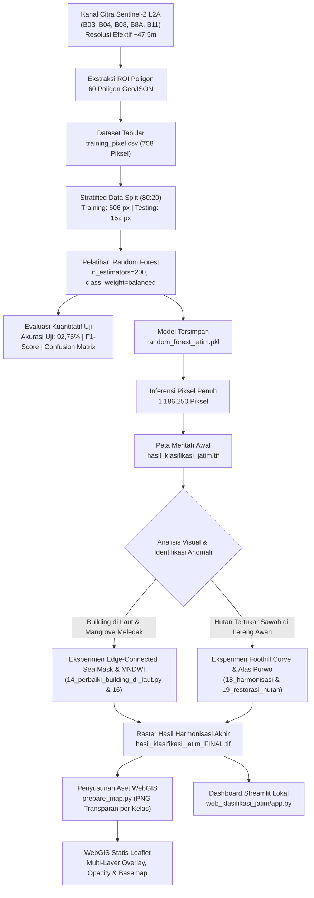

# Laporan Proyek: Klasifikasi Tutupan Lahan Jawa Timur Berbasis Citra Satelit Sentinel-2 dan Algoritma Random Forest

> **Mata Kuliah:** Penginderaan Jauh & Sains Data Spasial  
> **Wilayah Studi:** Jawa Timur Bagian Timur (Kabupaten Banyuwangi dan Sekitarnya)  
> **Platform & Teknologi:** Python, GeoPandas, Rasterio, Scikit-Learn, Leaflet.js, Streamlit, Sentinel-2 L2A  
> **Format Dokumentasi:** Markdown Kompatibel HackMD  

---

## Daftar Isi
1. [Pendahuluan dan Business Understanding](#1-pendahuluan-dan-business-understanding)
2. [Data dan Wilayah Penelitian](#2-data-dan-wilayah-penelitian)
3. [Kelas Tutupan Lahan](#3-kelas-tutupan-lahan)
4. [Digitasi dan Data Training](#4-digitasi-dan-data-training)
5. [Metodologi dan Alur Kerja](#5-metodologi-dan-alur-kerja)
6. [Hasil Evaluasi Model](#6-hasil-evaluasi-model)
7. [Hasil Klasifikasi & Evolusi Raster](#7-hasil-klasifikasi--evolusi-raster)
8. [Implementasi Antarmuka WebGIS](#8-implementasi-antarmuka-webgis)
9. [Keterbatasan dan Evaluasi Kritis](#9-keterbatasan-dan-evaluasi-kritis)
10. [Kesimpulan dan Saran](#10-kesimpulan-dan-saran)
11. [Struktur Direktori dan Panduan Menjalankan](#11-struktur-direktori-dan-panduan-menjalankan)

---

## 1. Pendahuluan dan Business Understanding

### 1.1 Latar Belakang
Pemantauan tutupan lahan (*land cover monitoring*) merupakan instrumen mendasar dalam perencanaan tata ruang wilayah, pengelolaan sumber daya alam, perlindungan kawasan konservasi, dan evaluasi ketahanan pangan berkelanjutan. Wilayah timur Provinsi Jawa Timur, khususnya Kabupaten Banyuwangi dan sekitarnya, merepresentasikan bentang alam yang sangat beragam dan kompleks. Wilayah ini memadukan kawasan konservasi hutan hujan tropis pegunungan (Gunung Ijen, Gunung Raung, dan Taman Nasional Meru Betiri), dataran rendah sentra pertanian padi irigasi teknis yang produktif, pusat permukiman perkotaan dan perdesaan, koridor pesisir Selat Bali, hingga ekosistem mangrove di Semenanjung Alas Purwo.

Citra satelit multispektral Sentinel-2 Level-2A (*Bottom of Atmosphere / BOA Surface Reflectance*) dari European Space Agency (ESA) melalui program Copernicus menyediakan data observasi bumi yang konsisten untuk pemetaan tutupan lahan. Melalui pemanfaatan teknik *machine learning* dan pemrosesan citra digital, proses pemetaan tutupan lahan dapat dilakukan secara terstruktur, terbarukan, dan mencakup area spasial yang luas tanpa harus bergantung sepenuhnya pada survei terestrial berskala penuh yang memakan biaya dan waktu tinggi.

### 1.2 Rumusan Masalah
1. **Tumpang Tindih Spektral Antarkelas (*Spectral Overlap*):** Terjadi kemiripan respon pantulan antara vegetasi alami rimbun (hutan pegunungan) dengan vegetasi budidaya subur (tanaman padi pada fase vegetatif aktif). Selain itu, tanah bera atau lahan kering pada persawahan sering memantulkan spektrum yang serupa dengan material atap seng/beton di kawasan permukiman.
2. **Anomali Piksel Awan Kumulus dan Bayangan Relief Curam:** Citra optik pada wilayah pegunungan tropis memuat tutupan awan kumulus putih kecil (*popcorn clouds*) dan bayangan topografi yang pekat. Model machine learning berbasis piksel murni yang tidak dilatih pada kelas atmosferik rentan memprediksi awan sebagai bangunan/sawah kering, serta memprediksi bayangan relief sebagai badan air atau mangrove.
3. **Kesalahan Spasial Ekstrem Hasil Klasifikasi Mentah:** Model *Random Forest* standar yang beroperasi per piksel tanpa kendala spasial (*spatial constraint*) menghasilkan anomali visual yang tidak masuk akal secara geografis, seperti kemunculan piksel permukiman (*Building*) di tengah perairan Selat Bali dan ledakan kelas mangrove di laut lepas terbuka.

### 1.3 Tujuan Proyek
1. Mengembangkan alur kerja terstruktur untuk ekstraksi fitur multispektral Sentinel-2 L2A menggunakan poligon *Region of Interest* (ROI) berformat GeoJSON.
2. Melatih dan mengevaluasi model klasifikasi *Random Forest* untuk mengidentifikasi 5 kelas tutupan lahan: *Building, Farmland, Water, Forest,* dan *Mangrove*.
3. Menganalisis dan menanggulangi anomali spasial hasil prediksi awal (seperti fenomena bangunan di laut, mangrove palsu di air terbuka, serta sawah palsu di lereng gunung) melalui eksperimen perbaikan pascaklasifikasi berbasis aturan spektral dan geomorfologis tanpa mengubah poligon training awal.
4. Membangun platform diseminasi geospasial berbasis web:
   - Website statis interaktif berbasis HTML, CSS, JavaScript, dan Leaflet.js dengan kontrol transparansi dan layer mandiri (5 checkbox kelas).
   - Aplikasi dashboard analitik berbasis Python Streamlit dan Folium untuk eksplorasi metrik tutupan lahan di lingkungan lokal.

### 1.4 Manfaat
- Menyediakan peta tutupan lahan terintegrasi untuk mendukung inventarisasi Lahan Pertanian Pangan Berkelanjutan (LP2B) di kawasan agraris Banyuwangi.
- Memberikan gambaran spasial kondisi tutupan kanopi hutan lindung dan kawasan taman nasional (TN Alas Purwo dan TN Meru Betiri).
- Menjadi studi kasus terapan dalam sains data geospasial yang mendemonstrasikan integrasi antara algoritma machine learning, pemrosesan citra digital, dan diseminasi WebGIS.

---

## 2. Data dan Wilayah Penelitian

### 2.1 Cakupan Geografis Aktual
Wilayah penelitian difokuskan pada **Kabupaten Banyuwangi dan sekitarnya (kawasan ujung timur Provinsi Jawa Timur)**, dan **bukan mencakup seluruh Provinsi Jawa Timur secara keseluruhan**. Penegasan batas ini didasarkan pada *bounding box* koordinat geografis aktual dari file raster GeoTIFF Sentinel-2 yang dianalisis dalam proyek ini.

Berdasarkan metadata georeferensi GeoTIFF aktual (`EPSG:4326`), batas koordinat wilayah penelitian adalah:
- **Batas Barat (*Min Longitude*):** $113{,}8721975^\circ\text{ E}$ (Lereng Pegunungan Raung dan Meru Betiri)
- **Batas Timur (*Max Longitude*):** $114{,}4115945^\circ\text{ E}$ (Perairan Selat Bali)
- **Batas Selatan (*Min Latitude*):** $-8{,}6024119^\circ\text{ S}$ (Samudra Hindia dan Ujung Semenanjung Alas Purwo)
- **Batas Utara (*Max Latitude*):** $-8{,}1971798^\circ\text{ S}$ (Lereng utara Gunung Ijen / Wongsorejo)
- **Titik Pusat Koordinat:** $-8{,}3997959^\circ\text{ S}, 114{,}1418960^\circ\text{ E}$
- **Dimensi Raster:** $1.250\text{ kolom} \times 949\text{ baris}$ (Total: $1.186.250\text{ piksel}$)
- **Bentang Geografis:** $\approx 59{,}9\text{ km (lebar)} \times 44{,}8\text{ km (panjang)}$
- **Estimasi Luas Area Cakupan:** $\approx 2.683\text{ km}^2$

### 2.2 Resolusi Asli Sensor vs Resolusi Efektif Raster yang Digunakan
Penting untuk membedakan antara spesifikasi sensor asli Sentinel-2 dan format raster hasil unduhan yang benar-benar diproses dalam proyek ini:

1. **Resolusi Asli Sensor Sentinel-2 (MSI):**
   - Kanal tampak dan NIR lebar (B02, B03, B04, B08): $10\text{ meter}$.
   - Kanal Red Edge dan SWIR (B05, B06, B07, B8A, B11, B12): $20\text{ meter}$.
   - Kanal atmosferik (B01, B09, B10): $60\text{ meter}$.

2. **Resolusi Efektif Raster Hasil Unduhan di Workspace:**
   - Seluruh file citra GeoTIFF yang tersedia di workspace (`2026-10-06-..._Sentinel-2_L2A_B*.tiff`) telah di-resampling dan diunduh pada grid spasial seragam dengan sistem koordinat WGS 84 (`EPSG:4326`).
   - Ukuran piksel matematis dari metadata affine transform raster adalah:
     $$\Delta\text{Lon} = 0{,}0004315176^\circ \quad \text{dan} \quad \Delta\text{Lat} = 0{,}0004270096^\circ$$
   - Pada posisi lintang rata-rata wilayah kajian ($\approx -8{,}4^\circ\text{ S}$):
     $$\text{Resolusi Bujur} \approx 0{,}0004315176^\circ \times (111.320\text{ m} \times \cos(-8{,}4^\circ)) \approx 47{,}52\text{ meter}$$
     $$\text{Resolusi Lintang} \approx 0{,}0004270096^\circ \times 110.574\text{ m} \approx 47{,}21\text{ meter}$$
   - Dengan demikian, **resolusi spasial efektif raster yang benar-benar digunakan dalam proyek ini adalah sekitar $47{,}5\text{ meter per piksel}$**, bukan $10\text{ meter}$. Setiap piksel pada raster merepresentasikan area permukaan bumi seluas $\approx 2.243\text{ m}^2$ ($\approx 0{,}224\text{ hektar}$).

### 2.3 Kanal Spektral yang Digunakan
Citra terekam pada **6 Oktober 2026** (`2026-10-06`) dengan tingkat pemrosesan Level-2A (BOA Surface Reflectance).

| Nama File Band | Band Sentinel-2 | Panjang Gelombang ($\lambda$) | Resolusi Asli Sensor | Resolusi Efektif Raster | Peran dalam Proyek |
| :--- | :---: | :---: | :---: | :---: | :--- |
| `...Sentinel-2_L2A_B03_(Raw).tiff` | **B03 (Green)** | $560\text{ nm}$ | $10\text{ m}$ | $\approx 47{,}5\text{ m}$ | Kalkulasi indeks air MNDWI |
| `...Sentinel-2_L2A_B04_(Raw).tiff` | **B04 (Red)** | $665\text{ nm}$ | $10\text{ m}$ | $\approx 47{,}5\text{ m}$ | Fitur training Random Forest & NDVI |
| `...Sentinel-2_L2A_B08_(Raw).tiff` | **B08 (Broad NIR)** | $842\text{ nm}$ | $10\text{ m}$ | $\approx 47{,}5\text{ m}$ | Fitur training Random Forest & biomasa |
| `...Sentinel-2_L2A_B8A_(Raw).tiff` | **B8A (Narrow NIR)** | $865\text{ nm}$ | $20\text{ m}$ | $\approx 47{,}5\text{ m}$ | Fitur training Random Forest (Narrow NIR) |
| `...Sentinel-2_L2A_B11_(Raw).tiff` | **B11 (SWIR-1)** | $1610\text{ nm}$ | $20\text{ m}$ | $\approx 47{,}5\text{ m}$ | Fitur training Random Forest, MNDWI, NDBI |

> **Koreksi Istilah Spektral B8A:** Kanal **B8A adalah Narrow Near-Infrared (Narrow NIR)** dengan lebar pita $32\text{ nm}$ yang berpusat pada panjang gelombang $865\text{ nm}$, dan **bukan kanal Red Edge**. Kanal Red Edge pada Sentinel-2 adalah B05 ($705\text{ nm}$), B06 ($740\text{ nm}$), dan B07 ($783\text{ nm}$).
> 
> **Fitur Model Latih:** Berdasarkan script `01_ekstraksi_training.py` dan `03_training_random_forest.py`, model Random Forest dilatih menggunakan **4 fitur kanal: B04, B08, B8A, dan B11**. Band B03 digunakan secara terpisah pada proses pascaklasifikasi untuk perhitungan indeks MNDWI.

---

## 3. Kelas Tutupan Lahan

Penelitian ini membagi tutupan lahan ke dalam 5 kelas tipologis:

| Kode | Kelas (EN) | Kelas (ID) | Kode Warna | Simbol | Karakteristik Biofisik & Kenampakan Spektral |
| :---: | :--- | :--- | :---: | :---: | :--- |
| **1** | **Building** | Perkotaan / Lahan Terbangun | `#E53935` | 🟥 Merah | Permukiman padat, bangunan komersial, gedung perkantoran, kawasan industri, dan jaringan jalan aspal/beton. Ditandai oleh pantulan SWIR (B11) dan Red (B04) yang relatif tinggi serta nilai NDBI positif. |
| **2** | **Farmland** | Sawah / Lahan Pertanian | `#FBC02D` | 🟨 Kuning | Lahan pertanian tanaman pangan (padi sawah), tegalan, dan hortikultura di dataran rendah Banyuwangi. Memiliki variasi spektral dinamis tergantung fase tanam (tergenang air saat pengolahan tanah, hijau saat vegetatif, dan memantulkan tanah saat fase bera/pasca-panen). |
| **3** | **Water** | Perairan | `#1E88E5` | 🟦 Biru | Badan air permukaan terbuka mencakup Selat Bali, Samudra Hindia, muara sungai, dan danau kawah. Memiliki daya serap radiasi sangat tinggi pada gelombang inframerah (B08, B8A, dan B11 mendekati nilai terendah). |
| **4** | **Forest** | Hutan | `#2E7D32` | 🟩 Hijau | Hutan hujan dataran rendah hingga hutan pegunungan berkanopi rapat di kawasan Gunung Ijen, Gunung Raung, Meru Betiri, dan Semenanjung Alas Purwo. Ditandai oleh serapan klorofil kuat pada spektrum merah (B04 rendah) dan pantulan sel daun sangat tinggi pada NIR (B08 dan B8A tinggi). |
| **5** | **Mangrove** | Hutan Mangrove | `#8E24AA` | 🟪 Ungu | Formasi hutan pasang surut air asin pada zona pesisir berlumpur (khususnya habitat alami Teluk Pangpang). Memiliki respon gabungan antara kanopi vegetasi rapat dengan substrat tanah basah/berair di bawahnya. |

---

## 4. Digitasi dan Data Training

### 4.1 Sumber Data Poligon GeoJSON
Data latih disusun melalui digitasi manual poligon *Region of Interest* (ROI) pada citra Sentinel-2 dan citra resolusi tinggi referensi. File GeoJSON acuan final yang digunakan dalam ekstraksi adalah:
- **Nama File:** `training_jatim_mangrove_diperkecil_clean.geojson`
- **Sistem Proyeksi Koordinat:** Geographic Coordinate System WGS 84 (`EPSG:4326`)
- **Total Jumlah Poligon:** **60 poligon**

#### Distribusi Poligon per Kelas:
- **Building:** 13 poligon
- **Farmland:** 13 poligon
- **Forest:** 12 poligon
- **Mangrove:** 12 poligon
- **Water:** 10 poligon

### 4.2 Pembersihan Geometri (`02_bersihkan_geojson.py`)
Tahap pembersihan geometri dilakukan menggunakan GeoPandas dan Shapely untuk memastikan kualitas topologi poligon sebelum pemrosesan raster:
1. Validasi penamaan atribut kelas agar sesuai dengan skema 5 kelas baku.
2. Pemfilteran fitur dengan geometri kosong (*null/empty geometry*).
3. Rekonstruksi geometri tidak valid (seperti *self-intersecting polygons* atau simpul ganda) menggunakan operasi topologi Shapely.

### 4.3 Ekstraksi Nilai Piksel ke CSV (`01_ekstraksi_training.py`)
Setiap poligon GeoJSON dioverlaykan ke atas kanal citra Sentinel-2 menggunakan fungsi `rasterio.mask.mask`. Nilai reflektansi piksel dari kanal **B04, B08, B8A, dan B11** diekstrak dan disimpan ke dalam file tabular `training_pixel.csv`.

#### Distribusi Piksel Sampel Training Aktual:
| Nama Kelas | Kode Kelas | Jumlah Piksel Sampel | Persentase Sampel |
| :--- | :---: | :---: | :---: |
| **Mangrove** | 5 | 289 piksel | 38,13% |
| **Water** | 3 | 166 piksel | 21,90% |
| **Building** | 1 | 146 piksel | 19,26% |
| **Farmland** | 2 | 93 piksel | 12,27% |
| **Forest** | 4 | 64 piksel | 8,44% |
| **Total** | - | **758 piksel** | **100,00%** |

> **Catatan Pembobotan Kelas:** Jumlah piksel sampel mangrove (289 piksel) mendominasi dataset karena kanopi mangrove pada poligon Teluk Pangpang relatif homogen dan padat. Untuk menyeimbangkan kontribusi sampel antarkelas saat pelatihan, model Random Forest dikonfigurasi dengan parameter `class_weight='balanced'`.

---

## 5. Metodologi dan Alur Kerja

Alur kerja proyek dirancang secara komprehensif mulai dari pemrosesan data mentah, pelatihan model, evaluasi kuantitatif, eksperimen perbaikan pascaklasifikasi, hingga diseminasi WebGIS:



### Uraian Tahapan Kerja:
1. **Prapemrosesan Citra:** Pemeriksaan kanal Sentinel-2 L2A tingkat reflektansi permukaan dan verifikasi konsistensi koordinat geografis.
2. **Ekstraksi Fitur:** Ekstraksi nilai piksel dari poligon ROI GeoJSON ke dalam format CSV multi-fitur (758 piksel sampel).
3. **Pelatihan Model:** Pelatihan model *Random Forest* dengan 200 *estimators* dan pembobotan seimbang (*balanced class weight*).
4. **Validasi Model:** Pengujian model terhadap 152 piksel testing independen menggunakan metrik akurasi, presisi, *recall*, skor F1, dan *confusion matrix*.
5. **Klasifikasi Penuh Citra (*Scene-wide Inference*):** Menerapkan model pada seluruh 1.186.250 piksel citra raster ($1.250 \times 949$).
6. **Eksperimen Perbaikan Pascaklasifikasi:** Mengatasi anomali spasial (bangunan di laut, mangrove meledak di perairan lepas, dan tutupan awan di pegunungan) melalui aturan deterministik spektral dan geomorfologis tanpa mengubah poligon training.
7. **Diseminasi Interaktif:** Mengekspor raster terharmonisasi menjadi aset visual berlapisan transparan untuk website Leaflet dan aplikasi dashboard Streamlit lokal.

---

## 6. Hasil Evaluasi Model

### 6.1 Parameter Model Random Forest
Konfigurasi model pada script `03_training_random_forest.py`:
- **Algoritma:** Random Forest Classifier (`sklearn.ensemble.RandomForestClassifier`)
- **Jumlah Estimator (`n_estimators`):** `200`
- **Pembobotan Kelas (`class_weight`):** `'balanced'`
- **Random State:** `42`
- **Metode Pembagian Data:** *Stratified Train-Test Split* (80% latih, 20% uji)
- **Data Training:** 606 piksel
- **Data Testing:** 152 piksel

### 6.2 Metrik Kinerja Evaluasi Aktual
Pengujian model terhadap 152 piksel data testing independen menghasilkan:
- **Akurasi Keseluruhan (*Overall Accuracy*):** **92,76%** (`0.9276`)

#### Tabel Classification Report Aktual:
| Kelas Tutupan Lahan | Presisi (*Precision*) | Perolehan (*Recall*) | Skor F1 (*F1-Score*) | Dukungan (*Support*) |
| :--- | :---: | :---: | :---: | :---: |
| **Building** | 0,96 | 0,93 | 0,95 | 29 piksel |
| **Farmland** | 0,74 | 0,74 | 0,74 | 19 piksel |
| **Forest** | 0,64 | 0,69 | 0,67 | 13 piksel |
| **Mangrove** | 1,00 | 1,00 | 1,00 | 58 piksel |
| **Water** | 1,00 | 1,00 | 1,00 | 33 piksel |
| **Rata-rata Makro (*Macro Avg*)** | **0,87** | **0,87** | **0,87** | **152 piksel** |
| **Rata-rata Tertimbang (*Weighted Avg*)** | **0,93** | **0,93** | **0,93** | **152 piksel** |

### 6.3 Confusion Matrix Aktual
Matriks kebingungan (*confusion matrix*) pada 152 piksel data testing:

| Kelas Aktual \ Prediksi | Building | Farmland | Water | Forest | Mangrove | Total Aktual |
| :--- | :---: | :---: | :---: | :---: | :---: | :---: |
| **Building** | **27** | 1 | 0 | 1 | 0 | 29 |
| **Farmland** | 1 | **14** | 0 | 4 | 0 | 19 |
| **Water** | 0 | 0 | **33** | 0 | 0 | 33 |
| **Forest** | 0 | 4 | 0 | **9** | 0 | 13 |
| **Mangrove** | 0 | 0 | 0 | 0 | **58** | 58 |

#### Analisis Evaluasi & Batasan Representasi:
- Kelas **Water** (33 piksel) dan **Mangrove** (58 piksel) terklasifikasi sempurna ($100\%$) pada sampel uji poligon homogen.
- Kelas **Building** mencapai kinerja tinggi dengan 27 dari 29 piksel terprediksi benar.
- Terdapat **kebingungan timbal-balik yang nyata antara Farmland dan Forest**: sebanyak 4 piksel Farmland terprediksi sebagai Forest, dan 4 piksel Forest terprediksi sebagai Farmland. Hal ini membuktikan kemiripan respon spektral kanopi pohon dan tanaman padi subur pada kanal 4-band.
- **Peringatan Penting mengenai Akurasi:** Angka akurasi pengujian sebesar **92,76%** dihitung secara murni pada 152 piksel sampel uji independen dari poligon ROI yang bersih. **Akurasi ini tidak secara otomatis menggambarkan akurasi seluruh peta raster (1.186.250 piksel)**. Di luar poligon sampel, terdapat fenomena turbiditas air, reflektansi pasir pantai, awan kumulus, bayangan lereng terjal, serta campuran piksel heterogen yang memicu kesalahan spasial pada inferensi penuh citra.

### 6.4 Tingkat Kepentingan Fitur (*Feature Importance*)
Kontribusi matematis setiap kanal spektral dalam membagi simpul-simpul pohon keputusan (*Gini importance*):

| Peringkat | Fitur Spektral | Karakteristik Kanal | Nilai *Importance* | Kontribusi |
| :---: | :---: | :--- | :---: | :---: |
| **1** | **B11** | Short-Wave Infrared 1 (SWIR-1) | `0.338057` | **33,81%** |
| **2** | **B8A** | Narrow Near-Infrared (Narrow NIR) | `0.333975` | **33,40%** |
| **3** | **B04** | Red | `0.165751` | **16,58%** |
| **4** | **B08** | Broad Near-Infrared (NIR) | `0.162217` | **16,22%** |

> **Interpretasi Fisik Fitur:** Kanal B11 (SWIR-1) dan B8A (Narrow NIR) memberikan kontribusi kumulatif sebesar **67,21%**. SWIR-1 sangat efektif membedakan kelembapan tanah, kadar air kanopi daun, dan material kedap air bangunan. Sementara itu, Narrow NIR berpusat pada $865\text{ nm}$ sangat sensitif terhadap kerapatan struktur sel daun vegetasi tanpa terganggu oleh serapan uap air atmosferik.

---

## 7. Hasil Klasifikasi & Evolusi Raster

Seluruh raster yang dihasilkan memiliki dimensi $1.250 \times 949\text{ piksel}$ (**1.186.250 piksel**), sistem koordinat WGS 84 (`EPSG:4326`), dan ukuran piksel transform $\approx 0{,}0004315^\circ \times 0{,}0004270^\circ$ (resolusi efektif $\approx 47{,}5\text{ meter per piksel}$).

### 7.1 Tabel Komparasi Statistik Seluruh File Raster (Terverifikasi Rasterio)
Statistik piksel berikut dihitung langsung menggunakan library Rasterio terhadap file raster yang benar-benar ada di direktori kerja:

| Nama File Raster | Building (1) | Farmland (2) | Water (3) | Forest (4) | Mangrove (5) | Karakteristik & Status File |
| :--- | :---: | :---: | :---: | :---: | :---: | :--- |
| **`hasil_klasifikasi_jatim.tif`** | 140.076 px<br>(11,81%) | 533.844 px<br>(45,00%) | 44.897 px<br>(3,78%) | 292.922 px<br>(24,69%) | 174.511 px<br>(14,71%) | **Raster Mentah Awal (Raw Output):** Prediksi langsung model Random Forest. Memiliki anomali bangunan di laut lepas dan ledakan mangrove di Selat Bali. |
| **`hasil_klasifikasi_jatim_smooth.tif`** | 110.438 px<br>(9,31%) | 593.389 px<br>(50,02%) | 193.751 px<br>(16,33%) | 275.651 px<br>(23,24%) | 13.021 px<br>(1,10%) | **Eksperimen Filter Smoothing:** Menggunakan *majority filter* jendela lokal. Mengurangi bercak kecil, namun batas kelas menjadi kabur dan belum menyelesaikan anomali laut secara tuntas. |
| **`hasil_klasifikasi_jatim_mangrove_koridor_pesisir.tif`** | 158.694 px<br>(13,38%) | 533.932 px<br>(45,01%) | 167.843 px<br>(14,15%) | 318.797 px<br>(26,87%) | 6.984 px<br>(0,59%) | **Eksperimen Pembatasan Mangrove:** Mangrove dibatasi secara spasial pada zona intertidal pesisir Teluk Pangpang. Mangrove menyusut drastis dari 174.511 ke 6.984 piksel. |
| **`hasil_klasifikasi_jatim_building_diperbaiki.tif`** | 138.419 px<br>(11,67%) | 533.844 px<br>(45,00%) | 46.554 px<br>(3,92%) | 292.922 px<br>(24,69%) | 174.511 px<br>(14,71%) | **Eksperimen Filter Bangunan Laut:** Menggunakan mask laut terhubung tepi citra untuk menghapus bangunan palsu di laut tanpa mengubah daratan. |
| **`hasil_klasifikasi_jatim_FINAL.tif`** | **97.391 px<br>(8,21%)** | **440.701 px<br>(37,15%)** | **106.089 px<br>(8,94%)** | **536.945 px<br>(45,26%)** | **5.124 px<br>(0,43%)** | **Raster Hasil Harmonisasi Akhir:** Hasil integrasi rangkaian perbaikan pascaklasifikasi. Anomali laut dibersihkan, mangrove terkonsentrasi di Teluk Pangpang, dan hutan pegunungan barat dirapikan dari gangguan awan. |

---

### 7.2 Masalah Klasifikasi Awal dan Eksperimen Solusinya

#### 1. Masalah dan Solusi Building di Laut Lepas
- **Gejala:** Muncul piksel merah (*Building*) yang tersebar di perairan laut Selat Bali dan pesisir selatan.
- **Penyebab Spektral:** Efek pantulan cahaya matahari pada riak gelombang laut (*sun glint*) serta sedimen pasir pantai dangkal memantulkan gelombang SWIR dan Red yang menyerupai nilai material bangunan.
- **Solusi Teknis (`14_perbaiki_building_di_laut.py` dan `16_perbaiki_klasifikasi_building.py`):**
  Deteksi perairan laut menggunakan indeks MNDWI:
  $$\text{MNDWI} = \frac{B_{03} - B_{11}}{B_{03} + B_{11}}$$
  Komponen biner air yang terhubung secara topologi dengan batas tepi luar citra diekstraksi (*edge-connected sea mask*). Seluruh piksel building yang berada di dalam mask laut lepas dikembalikan ke kelas **Water (3)** menggunakan operasi morfologi penutupan biner (*binary closing*).

#### 2. Eksperimen Mangrove (6.984 Piksel vs 174.511 Piksel Awal)
- **Gejala:** Kelas Mangrove memenuhi sebagian besar badan air Selat Bali dan samudra lepas (mencapai 174.511 piksel / 14,71% citra).
- **Penyebab Spektral:** Air laut dangkal yang keruh berpasir memiliki nilai reflektansi yang sangat mendekati sampel poligon mangrove basah pada ruang fitur 4-band.
- **Eksperimen Perbaikan (`13_batasi_mangrove_pesisir.py`):**
  Dilakukan pembatasan spasial koridor pesisir Teluk Pangpang yang menyisakan **6.984 piksel** (0,59%) pada file eksperimen `hasil_klasifikasi_jatim_mangrove_koridor_pesisir.tif`.
- **Telaah Kritis Hasil Eksperimen:**
  > **Catatan Evaluasi Penting:** Pengurangan dari 174.511 piksel menjadi 6.984 piksel harus dipahami secara objektif sebagai **hasil eksperimen pemfilteran heuristik**, bukan sebagai bukti mutlak bahwa peta tutupan mangrove sudah 100% benar. Meskipun secara visual berhasil melenyapkan kesalahan positif (*false positives*) di laut terbuka, langkah ini **belum membuktikan bahwa seluruh 6.984 piksel yang tersisa adalah mangrove sejati, dan belum membuktikan bahwa seluruh mangrove alami di pesisir berhasil dipertahankan tanpa ada yang terpotong (*omission error*)**. Pembuktian definitif memerlukan validasi lapangan (*ground truthing*) dengan titik koordinat GPS.

#### 3. Masalah Awan dan Bayangan Relief pada Hutan Pegunungan Barat
- **Gejala:** Kawasan pegunungan barat (Gunung Ijen, Gunung Raung, dan Meru Betiri) yang merupakan hutan lebat tampak berlubang dan dipenuhi bercak kuning (*Farmland/Sawah*).
- **Penyebab Spektral:** Citra satelit tanggal 6 Oktober 2026 memuat tutupan awan kumulus kecil (*popcorn clouds*) dan bayangan awan serta bayangan relief terjal (>111.000 piksel). Karena model tidak dilatih pada piksel awan, pantulan tinggi awan diprediksi sebagai sawah kering/bangunan, sementara bayangan awan diprediksi sebagai sawah basah.
- **Solusi Restorasi Final (`19_restorasi_hutan_pegunungan_barat.py`):**
  Menerapkan batas geomorfologis alami kaki gunung (*foothill curve*) yang melengkung mulus dari utara ke selatan:
  $$\text{Col}_{\text{foothill}} = 425 - 0{,}095 \times \text{Row} + 16 \times \sin\left(\frac{\text{Row}}{140}\right)$$
  Bentang alam lereng pegunungan di sisi barat garis kontur dikembalikan menjadi **Forest (4)** solid, menghilangkan lubang awan dan sawah palsu. Permukiman nyata di lembah kaki gunung (Kalibaru, Glenmore, Licin) tetap dipertahankan sebagai **Building (1)** menggunakan kombinasi indeks NDBI dan NDVI. Selain itu, piksel bangunan palsu di pedalaman Taman Nasional Alas Purwo dibersihkan menjadi **Forest (4)**.

---

## 8. Implementasi Antarmuka WebGIS

Proyek ini menyediakan dua bentuk platform diseminasi: website statis berbasis Leaflet.js dan aplikasi dashboard berbasis Streamlit.

### 8.1 Website Statis Leaflet (`web_statis_jatim`)
Aplikasi web statis dibangun di folder `web_statis_jatim/` dengan arsitektur ringan tanpa server (*serverless*) yang dapat dijalankan melalui web server lokal sederhana.
- **Komponen Berkas:**
  - `index.html`: Struktur antarmuka semantik dengan panel kontrol mengambang (*floating glassmorphism panel*).
  - `style.css`: Desain antarmuka modern bertema gelap (*dark mode*) dengan tipografi Plus Jakarta Sans dan tata letak responsif.
  - `script.js`: Logika interaktif peta Leaflet, pemuatan layer independen, slider opasitas, dan sinkronisasi metadata.
  - `prepare_map.py`: Script generator aset visual dari raster master.

### 8.2 Konversi Raster ke Aset Web (`prepare_map.py`)
Script `prepare_map.py` membaca raster `hasil_klasifikasi_jatim_FINAL.tif` dan menghasilkan aset pada direktori `web_statis_jatim/assets/`:
1. **5 Lapisan Citra PNG Transparan RGBA per Kelas:**
   - `building.png` (Merah `#E53935`, alpha = 255 pada kelas 1, alpha = 0 di luar kelas)
   - `farmland.png` (Kuning `#FBC02D`, alpha = 255 pada kelas 2, alpha = 0 di luar kelas)
   - `water.png` (Biru `#1E88E5`, alpha = 255 pada kelas 3, alpha = 0 di luar kelas)
   - `forest.png` (Hijau `#2E7D32`, alpha = 255 pada kelas 4, alpha = 0 di luar kelas)
   - `mangrove.png` (Ungu `#8E24AA`, alpha = 255 pada kelas 5, alpha = 0 di luar kelas)
   Setiap gambar PNG dibuat sepenuhnya transparan pada piksel di luar kelasnya sehingga dapat ditumpuk secara dinamis (*stackable image overlays*) menggunakan fungsi `L.imageOverlay` Leaflet.
2. **Metadata Georeferensi `bounds.json`:**
   Menyimpan koordinat batas geografis `[[South, West], [North, East]]`, titik pusat peta, dimensi raster, jumlah piksel, dan persentase luasan setiap kelas untuk sinkronisasi antarmuka.

### 8.3 Fitur-Fitur Interaktif Website Statis
1. **Kontrol Lapisan Mandiri (Checkbox 5 Kelas):** Pengguna dapat mengaktifkan atau mematikan visualisasi setiap kelas tutupan lahan secara mandiri, didukung tombol pintas *Pilih Semua* dan *Sembunyikan Semua*.
2. **Slider Transparansi Dinamis:** Mengatur transparansi lapisan tutupan lahan dari 0% hingga 100% (bawaan: 85%) untuk membandingkan batas klasifikasi langsung dengan citra satelit di bawahnya.
3. **Pilihan Peta Dasar (*Basemap Switcher*):**
   - *Esri World Imagery:* Citra satelit resolusi tinggi fotorealistik tanpa tutupan awan.
   - *Esri Satelit + Label Batas:* Citra satelit dilengkapi toponimi jalan dan batas administratif.
   - *OpenStreetMap:* Peta vektor standar jaringan jalan dan permukiman.
4. **Tombol Fokus Wilayah (*Recenter*):** Mengembalikan posisi dan zoom peta ke cakupan penuh wilayah kajian secara instan.
5. **Indikator Real-Time:** Menampilkan koordinat kursor kursor (Latitude, Longitude) dan level zoom di sudut kiri bawah layar.

### 8.4 Dashboard Streamlit (`web_klasifikasi_jatim`)
Aplikasi dashboard analitik dibangun menggunakan Python Streamlit di folder `web_klasifikasi_jatim/app.py`.
- **Pustaka Utama:** Python, Streamlit, Folium (`streamlit-folium`), Rasterio, Pandas, NumPy, Matplotlib.
- **Fitur Dashboard:**
  1. *Deteksi Raster Otomatis:* Mendeteksi dan memuat file `hasil_klasifikasi_jatim_FINAL.tif`.
  2. *Unggah GeoTIFF Mandiri:* Fasilitas bagi pengguna untuk mengunggah dan menganalisis file GeoTIFF klasifikasi lain.
  3. *Visualisasi Peta Folium:* Peta interaktif dengan layer tutupan lahan, slider opasitas, dan opsi basemap.
  4. *Analitik Luasan & Grafik:* Kartu ringkasan jumlah piksel, estimasi luas hektar/km², dan grafik batang distribusi kelas.
  5. *Ekspor Ringkasan Data:* Opsi unduh tabel statistik dalam format CSV dan unduh file GeoTIFF.
  6. *Overlay Poligon Training:* Opsi menampilkan layer poligon GeoJSON training di atas peta.

### 8.5 Status Pengujian: Implementasi Lokal vs Deployment Cloud
> **Pernyataan Status Proyek Aktual:**  
> - **Implementasi Lokal (Terverifikasi Berfungsi):** Baik website statis Leaflet (`http://localhost:8000`) maupun aplikasi dashboard Streamlit (`http://localhost:8501`) telah **selesai dikembangkan dan teruji secara fungsional di lingkungan lokal**. Seluruh kode sumber, dependensi (`requirements.txt`), dan generator aset tersedia lengkap di workspace.  
> - **Deployment Cloud (Belum Dikerjakan):** Proyek ini **belum dideploy ke Streamlit Community Cloud (belum online publik)**. Status ini dicatat secara jujur sebagai batasan implementasi saat ini, karena tahap deployment cloud memerlukan pembuatan repositori publik GitHub terpisah serta penanganan ukuran file raster GeoTIFF yang besar.

---

## 9. Keterbatasan dan Evaluasi Kritis

### 9.1 Kesenjangan Akurasi Uji (92,76%) vs Realitas Seluruh Peta
Akurasi tinggi sebesar 92,76% pada data testing independen tidak serta merta mencerminkan akurasi sempurna pada seluruh bentang lahan:
- **Bias Lokasi Sampel:** Poligon ROI (758 piksel) diambil dari area yang relatif bersih dan homogen (kanopi pohon lebat, air jernih, sawah yang seragam).
- **Kompleksitas Spasial Sebenarnya:** Pada skala seluruh scene (1,18 juta piksel), model berhadapan dengan kondisi spektral yang tidak tercakup dalam sampel: turbiditas air laut, pantulan pasir pantai, atap seng berkarat, awan kumulus, dan bayangan lereng curam. Oleh karena itu, evaluasi spasial visual dan perbaikan pascaklasifikasi sangat krusial melengkapi metrik kuantitatif.

### 9.2 Keterbatasan Ambang Batas Spektral dan Mask Heuristik
Penggunaan indeks spektral deterministik (seperti MNDWI) dan kurva kontur geomorfologis (*foothill curve*) mengandalkan nilai ambang batas statis (*fixed threshold*). Nilai ini bersifat heuristik lokal untuk citra tanggal 6 Oktober 2026 dan rentan bergeser apabila diterapkan pada citra tanggal lain dengan perbedaan musim atau sudut penyinaran matahari.

### 9.3 Ketiadaan Validasi Lapangan Terestrial (Ground Truth)
Raster final `hasil_klasifikasi_jatim_FINAL.tif` merupakan produk perbaikan pascaklasifikasi berbasis aturan spasial. Meskipun peta ini secara visual jauh lebih bersih dan realistis dibandingkan hasil mentah, **peta ini belum melalui uji akurasi validasi lapangan independen menggunakan titik koordinat GPS**. Oleh karena itu, raster ini tidak boleh diklaim telah tervalidasi secara absolut di lapangan.

---

## 10. Kesimpulan dan Saran

### 10.1 Kesimpulan
1. Klasifikasi tutupan lahan wilayah Kabupaten Banyuwangi dan sekitarnya berhasil diimplementasikan menggunakan citra Sentinel-2 L2A (B04, B08, B8A, B11) dengan resolusi efektif $\approx 47{,}5\text{ meter per piksel}$ dan algoritma Random Forest, menghasilkan akurasi data uji sebesar **92,76%**.
2. Fitur kanal B11 (SWIR-1) sebesar **33,81%** dan B8A (Narrow NIR) sebesar **33,40%** menjadi prediktor paling penting dalam memisahkan badan air, material perkotaan, dan vegetasi.
3. Eksperimen perbaikan pascaklasifikasi berbasis aturan spektral dan geomorfologis berhasil menanggulangi anomali spasial peta awal tanpa mengubah data training:
   - Menghilangkan piksel bangunan di laut lepas via *edge-connected sea mask*.
   - Mereduksi ledakan mangrove di laut terbuka dari 174.511 piksel menjadi 6.984 piksel pada eksperimen pesisir, dan menjadi **5.124 piksel (0,43%)** pada raster harmonisasi akhir.
   - Merestorasi kawasan hutan pegunungan barat dan Alas Purwo secara solid (**536.945 piksel / 45,26%**) dari gangguan awan kumulus dan bayangan topografi.
   - Menjaga proporsi lahan pertanian sawah (**440.701 piksel / 37,15%**) dan perkotaan (**97.391 piksel / 8,21%**).
4. Hasil klasifikasi berhasil didiseminasikan dalam dua bentuk platform: website statis berbasis Leaflet.js dengan checkbox 5 kelas independen yang ringan dan responsif, serta dashboard analitik lokal berbasis Streamlit.

### 10.2 Saran Pengembangan Lanjutan
1. **Prapemrosesan Masking Awan Otomatis:** Mengintegrasikan algoritma deteksi awan otomatis (seperti *s2cloudless* atau *Fmask*) sebelum klasifikasi dilakukan untuk mencegah salah prediksi di puncak pegunungan.
2. **Integrasi Data Elevasi Digital (DEM):** Memasukkan data ketinggian dan kelerengan (*Digital Elevation Model* seperti DEMNAS atau SRTM 30m) langsung sebagai fitur input model Random Forest agar model dapat membedakan hutan pegunungan dan sawah dataran rendah secara alami.
3. **Penyampelan Temporal Jamak (*Multi-Temporal Composite*):** Memanfaatkan komposit citra multitemporal lintas musim untuk mengenali siklus dinamika sawah dan vegetasi musiman.
4. **Survei Validasi Lapangan Independen (*Ground Truth Survey*):** Melakukan pengambilan titik koordinat GPS lapangan untuk menghitung matriks akurasi peta akhir secara definitif.
5. **Deployment Cloud Publik:** Menyiapkan repositori publik GitHub terstruktur untuk mempublikasikan dashboard Streamlit ke Streamlit Community Cloud.

---

## 11. Struktur Direktori dan Panduan Menjalankan

### 11.1 Struktur Direktori Proyek Aktual
```text
D:\semester 5\psd\klasifikasi_jatim\
│
├── 2026-10-06-..._Sentinel-2_L2A_B03_(Raw).tiff    # Kanal Green (~47.5m)
├── 2026-10-06-..._Sentinel-2_L2A_B04_(Raw).tiff    # Kanal Red (~47.5m)
├── 2026-10-06-..._Sentinel-2_L2A_B08_(Raw).tiff    # Kanal Broad NIR (~47.5m)
├── 2026-10-06-..._Sentinel-2_L2A_B8A_(Raw).tiff    # Kanal Narrow NIR (~47.5m)
├── 2026-10-06-..._Sentinel-2_L2A_B11_(Raw).tiff    # Kanal SWIR-1 (~47.5m)
│
├── training_jatim_mangrove_diperkecil_clean.geojson# Poligon training bersih (60 poligon)
├── training_pixel.csv                              # Data piksel sampel terekstraksi (758 baris)
├── random_forest_jatim.pkl                         # Model Random Forest tersimpan
│
├── 01_ekstraksi_training.py                        # Ekstraksi piksel dari GeoJSON
├── 02_bersihkan_geojson.py                         # Validasi & perbaikan topologi GeoJSON
├── 03_training_random_forest.py                    # Pelatihan & evaluasi Random Forest
├── 04_klasifikasi_citra.py                         # Prediksi full-scene raster
├── 14_perbaiki_building_di_laut.py                 # Filter eliminasi bangunan di laut lepas
├── 15_klasifikasi_jatim_final.py                   # Script integrasi awal
├── 16_perbaiki_klasifikasi_building.py             # Refinement perkotaan & perairan darat
├── 17_perbaiki_klasifikasi_farmland.py             # Harmonisasi spasial persawahan
├── 18_harmonisasi_sawah_hutan.py                   # Filter kontur sawah vs hutan
├── 19_restorasi_hutan_pegunungan_barat.py          # Restorasi total hutan pegunungan barat
│
├── hasil_klasifikasi_jatim.tif                     # Raster mentah awal Random Forest
├── hasil_klasifikasi_jatim_smooth.tif              # Raster eksperimen smoothing
├── hasil_klasifikasi_jatim_mangrove_koridor_pesisir.tif # Raster eksperimen mangrove
├── hasil_klasifikasi_jatim_building_diperbaiki.tif # Raster eksperimen filter laut
├── hasil_klasifikasi_jatim_FINAL.tif               # Raster hasil harmonisasi akhir
│
├── Laporan_HackMD_Klasifikasi_Tutupan_Lahan_Jatim.md # Laporan dokumentasi lengkap proyek
│
├── web_statis_jatim/                               # Folder Aplikasi WebGIS Statis Leaflet
│   ├── index.html                                  # Antarmuka web peta Leaflet
│   ├── style.css                                   # Styling dark glassmorphism
│   ├── script.js                                   # Logika interaktif peta & kontrol layer
│   ├── prepare_map.py                              # Generator aset PNG transparan dari GeoTIFF
│   ├── README.md                                   # Dokumentasi web statis
│   └── assets/
│       ├── bounds.json                             # Metadata koordinat bounds & persentase
│       ├── building.png                            # Overlay transparan kelas Perkotaan
│       ├── farmland.png                            # Overlay transparan kelas Sawah
│       ├── forest.png                              # Overlay transparan kelas Hutan
│       ├── mangrove.png                            # Overlay transparan kelas Mangrove
│       └── water.png                               # Overlay transparan kelas Perairan
│
└── web_klasifikasi_jatim/                          # Folder Aplikasi Dashboard Streamlit
    ├── app.py                                      # Kode sumber dashboard Streamlit + Folium
    ├── README.md                                   # Dokumentasi menjalankan Streamlit
    └── requirements.txt                            # Ketergantungan pustaka Python Streamlit
```

### 11.2 Panduan Menjalankan Seluruh Pipeline

#### 1. Ekstraksi Data Latih dari Citra dan GeoJSON
```powershell
python 01_ekstraksi_training.py
```

#### 2. Pelatihan dan Evaluasi Model Random Forest
```powershell
python 03_training_random_forest.py
```

#### 3. Prediksi Klasifikasi Seluruh Citra Raster
```powershell
python 04_klasifikasi_citra.py
```

#### 4. Menjalankan Script Restorasi Final (Hutan Pegunungan & Alas Purwo)
```powershell
python 19_restorasi_hutan_pegunungan_barat.py
```

#### 5. Menyiapkan Aset WebGIS Statis (Konversi GeoTIFF ke PNG Transparan)
```powershell
cd web_statis_jatim
python prepare_map.py
cd ..
```

#### 6. Menjalankan Website Statis Leaflet (Lokal)
```powershell
python -m http.server 8000 --directory web_statis_jatim
```
Buka peramban (*web browser*) dan akses URL:
`http://localhost:8000`

#### 7. Menjalankan Aplikasi Dashboard Streamlit (Lokal)
```powershell
cd web_klasifikasi_jatim
streamlit run app.py
```
Akses dashboard Streamlit pada URL lokal bawaan:
`http://localhost:8501`
